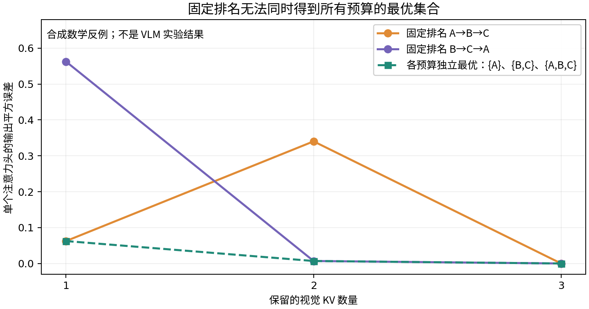
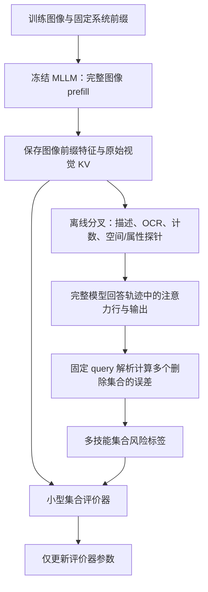

# 面向未知视觉查询的集合效应蒸馏与预算条件化 KV 选择

工作名：**SetDistill-KV**。英文题目候选：*Distilling Non-additive Deletion Effects for Query-Agnostic Visual KV Selection*。

日期：2026-11-13。定位：供导师审查的完整方法提案，尚非已有实验支持的论文结论。按 ICLR 方法论文的论证要求设计；具体投稿届次和截止日期需另行核实，不能把“今年 ICLR”视为仍开放投稿。本轮官方日程页面未能访问。

## 1. 立项摘要

现有视觉 KV 选择常将每个位置映射为一个重要性分数，再按预算截取排名。注意力、value 范数、删除单个位置的输出变化都能提供有效依据，但这些量不能完整描述多个位置同时删除的组合影响。特别是，一套固定排名隐含不同预算的保留集合互相嵌套；真实注意力输出重建目标并不总有这个性质。

本方案提出一个可检验的改变：**将离线监督对象从逐 token 重要性，改为预算内整个删除集合的局部输出影响；用低秩结构的小网络学习这一集合函数，在线以固定少量迭代选择原始视觉 KV。**

边界保持清楚：冻结视觉编码器和语言模型；完整处理图像前缀；不修改主干注意力、不产生合成 KV、不跨层共享 K/V；压缩时不可见未来用户问题；仅保留各层原生视觉 KV 的子集。文本 KV 正常保留和追加。

拟验证的三个假设：

1. **H1，集合效应：** 在真实多模态轨迹中，多个位置同时删除的输出变化存在足够显著的非可加性，忽略交互会影响同预算选择。
2. **H2，可蒸馏性：** 基于图像前缀的低维特征，可以预测这类集合风险在多个视觉技能上的相对大小，不需要在线获取未来问题或回答。
3. **H3，可兑现性：** 在固定少量选择迭代下，质量收益足以抵偿额外压缩成本，并形成更好的质量—缓存字节—多问耗时折中。

三个假设尚未被模型实验验证。已完成的是后文的数学恒等式、反例与小型优化计算的 CPU 核验。

## 2. 创新边界：已有工作做到哪里

本轮核查发现，以下内容均不能单独作为新贡献：使用未来注意力、冻结主干训练小网络、输出重建误差、视觉多样性、不同预算的缓存分配。

| 最近邻工作 | 已有内容 | 本方案应证明的具体差异 |
|---|---|---|
| **Fast KVzip**，Kim、Han、Yun，2026 | 从固定主干特征预测 KVzip 逐位置标签，低成本评分和淘汰 | 学习一个可评价不同删除集合的函数，保留组合影响；不能只换成多模态训练数据。[R1] |
| **ReST-KV**，An 等，作者标注 ICLR 2026 | 将注意力 odds ratio 与单位置输出重建误差结合，聚合/平滑后选择 Top-K | 必须超越单位置影响分数；核心比较是多个位置的交叉项是否值得学习。其公式构成理论背景，不是本方案首次提出。[R2] |
| **KV Policy**，Moschella、Manduchi、Sener，ICML 2026 | 用离线未来轨迹训练每头策略；其未来注意力奖励对 token 可加，支持预算间嵌套的统一排名 | 本方案针对非可加重建风险，允许在缓存构建时按预算产生不同集合，不依赖一套通用排名。[R3] |
| **MixKV**，Liu 等，作者声明 ICLR 2026 | 重要性、value 范数与 key 多样性结合 | 交互来自条件输出贡献，而非仅由 K 相似性定义；必须在相同教师信息和选择成本下比较。[R4] |
| **TRACE**，Wang 等，2026 technical report | 面向 GUI 轨迹的证据相关性、特征新颖性、覆盖与嵌套排序 | 它已考虑集合多样性，不能泛称现有方法全是独立打分。本方案学习另一种集合目标，且采用问题不可见的图像前缀协议。[R5] |

另需与 **LookaheadKV** 的未来响应注意力蒸馏、**CompilerKV** 的离线风险阈值、**VisionSelector** 的可学习视觉选择进行定位比较。[R6–R8] 这些工作说明，“风险”“未来”“可学习”都不能只作为新名称使用。

**拟主张的新颖性组合：** 多技能、问题不可见的图像前缀场景下，以非可加集合删除效应为监督，学习无需主干反向传播的结构化集合评价器，并以固定预算求解保留集合。这是当前检索支持的候选区别，不是已证明的全球首创性。

## 3. 明确任务与缓存对象

输入为图像及固定系统前缀。完整 prefill 得到每一层的视觉 KV 和固定的隐藏特征；用户问题随后到达。每个独立问题从同一份不可变图像前缀缓存分叉，问题与回答产生的缓存不回写公共图像缓存。

最小版本采用**每层一份视觉位置掩码，同层所有 KV heads 使用相同的位置集合**。不同层可选择不同位置。该约束避免起步就需要不等长 head 的专用缓存内核；本方案并不假定所有头的重要性相同，教师风险会汇总该层不同 query heads 的影响。更细的 per-KV-head 选择属于后续扩展。

令一张图在每层有 \(N\) 个视觉位置，第 \(\ell\) 层保留 \(B_\ell\) 个。定义删除掩码：

\[
\mathbf m_\ell\in\{0,1\}^{N},\qquad
\sum_{j=1}^{N}m_{\ell,j}=N-B_\ell.
\tag{1}
\]

\(\ell\) 是 Transformer 层编号；\(j\) 是视觉位置编号；\(\mathbf m_\ell\) 是长度为 \(N\) 的掩码向量；\(m_{\ell,j}=1\) 表示删除该位置的 K 和 V，等于 0 表示保留；\(B_\ell\) 是已知的本层视觉缓存预算；求和限制确保严格满足预算。非视觉位置不属于这组可删变量。

第一轮固定各层预算比例，不同时学习层预算。原来的跨层探针、K/V 共享、ViT/FFN 剪枝均不进入核心框架。

## 4. 数学依据一：固定 query 下的集合删除误差

先看某层某个 query head 的一次注意力。暂时省略层、头及时间下标。设当前 query 对全部合法位置的注意力为 \(a_i\)，对应 value 为 \(v_i\)：

\[
o=\sum_{i\in\mathcal A}a_i v_i,
\qquad \sum_{i\in\mathcal A}a_i=1.
\tag{2}
\]

\(\mathcal A\) 表示原始掩码允许访问的全部位置，包含视觉、系统文本、问题及此前生成文本；\(i\) 是这些位置的索引；\(a_i\ge0\) 是对完整合法集合归一化的 softmax 权重；\(v_i\in\mathbb R^{d_v}\) 是 value 列向量；\(d_v\) 是单头 value 维度；\(o\) 是该头在输出投影前的注意力输出。这里不能只对视觉位置做 softmax。

删除视觉集合 \(D\)，同时固定当前 query、其余 K/V 和原始 logits，只将删除位置移出 softmax 分母，得到：

\[
o_{-D}=\frac{o-\sum_{j\in D}a_jv_j}{1-\sum_{j\in D}a_j}.
\tag{3}
\]

\(D\subseteq\mathcal A\) 仅含被删视觉位置；\(j\) 是其中的位置；\(o_{-D}\) 是删除后的输出，下标 \(-D\) 表示移除集合；分子扣除被删贡献，分母重新归一化剩余注意力。要求剩余注意力总质量严格大于零。

定义每个视觉位置的中心化贡献及集合注意力质量：

\[
c_j=a_j(v_j-o),\qquad A_D=\sum_{j\in D}a_j.
\]

\(c_j\in\mathbb R^{d_v}\) 是该位置相对于完整输出的注意力加权偏离；\(A_D\) 是被删集合的原始注意力总量。由式 (3) 直接得到：

\[
\boxed{\ o_{-D}-o=-\frac{\sum_{j\in D}c_j}{1-A_D}\ },
\qquad
E(D)=\frac{\left\|\sum_{j\in D}c_j\right\|_2^2}{(1-A_D)^2}.
\tag{4}
\]

\(E(D)\) 定义为删除前后单头输出的平方欧氏距离；\(\|\cdot\|_2\) 是欧氏范数；分子是多个中心化贡献相加后的平方长度，分母是剩余注意力质量的平方。这个公式保留了注意力的作用，同时引入 value 的方向和集合组合。

展开分子：

\[
\left\|\sum_{j\in D}c_j\right\|_2^2
=\sum_{j\in D}\|c_j\|_2^2
+2\sum_{\substack{i,j\in D\\i<j}}c_i^\top c_j.
\tag{5}
\]

第一项累计各个贡献的平方长度；第二项遍历不同位置对，\(i<j\) 避免重复计数；上标 \(\top\) 表示转置，内积 \(c_i^\top c_j\) 衡量两个变化方向的一致或相反程度。该项可以为正或负，因而同时删除两个位置的影响可能相互放大或抵消。

**重要限定：** 这里的正负交互是隐藏向量中的输出变化，不能直接解释成语义上的“两个物体合作”或“某个物体无用”。语义解释需要图像、问题和真实回答验证。

### 与 ReST-KV 的关系

当 \(D\) 只有一个位置时，式 (4) 的误差范数退化为 \(a_j/(1-a_j)\) 乘以 \(\|v_j-o\|_2\)。这正是 ReST-KV 公开实现采用的单位置 output-reconstruction 指标结构。因此本方案**不以该单点公式为创新**，而是研究集合交叉项能否被蒸馏并用于实际选择。

### 精确性的范围

式 (4) 对固定 query 的局部注意力运算精确；真实压缩生成还会改变后续层隐藏状态、query 以及新生成的 K/V。它不是完整模型回答误差的精确表达，也不是生成质量保证。

第一版显式建模同一层内的位置组合，尚未建模跨层删除决策的交互。各层独立选择并不等于全模型联合最优，这也是必须进行真实稀疏生成验证的原因。

同层多个头可分别计算误差，再用固定规则汇总。若关注经过输出投影的误差，也可应用该层的输出矩阵；最小版本首先使用单头输出误差的归一化平均，并将输出投影后的误差作为专项验证，避免暗中把局部指标当作完整层输出。

## 5. 数学依据二：固定排名不总能适配所有预算

构造一个单头、一维 value 的例子。三个视觉位置 A、B、C 和一个始终保留的文本位置，原始 logits 全相等，因此每个位置注意力均为 \(1/4\)。四个 value 依次为 2、4、0、1，完整输出为 \(7/4\)。

| 视觉预算 | 保留集合 | 重新归一化后的输出 | 相对完整输出的平方误差 |
|---:|---|---:|---:|
| 1 | {A} | 3/2 | 1/16 |
| 1 | {B} | 5/2 | 9/16 |
| 1 | {C} | 1/2 | 25/16 |
| 2 | {A,B} | 7/3 | 49/144 |
| 2 | {A,C} | 1 | 9/16 |
| 2 | {B,C} | 5/3 | 1/144 |

预算为 1 的唯一最优集合是 {A}，预算为 2 的唯一最优集合是 {B,C}，前者不包含在后者中。任何固定排名的 Top-1 都必须包含于它的 Top-2，因此没有一套固定排名能在这个例子中同时实现两个预算的最优输出重建。

只保留文本时的平方误差为 9/16，视觉位置在这个例子中确实带来了非零重建收益；上述两个预算的最优误差也随预算增加而下降。

图中只有合成数学数据，不是 MLLM 性能实验。它证明的是固定预算无关排名的表达边界，不证明这种现象在真实模型中普遍或严重，也不排除预算条件化的标量评分器可以学出更好的集合。

**部署边界：** 本方案在缓存构建时已知预算，不宣称能在删掉 KV 后无代价恢复它们。若运行中扩大预算或要求重新选择不嵌套集合，需要额外备份或重计算，须另计成本。

## 6. 教师：从同一条完整轨迹生成大量集合标签

每张训练图像构造固定规则下的视觉探针。首轮可采用四组：描述与主要对象、OCR、计数、空间关系与属性。对每个问题从同一完整图像前缀分叉，取得模型回答，再通过 teacher forcing 记录对应注意力行。图像前缀特征必须在任何探针问题到达之前保存，防止将未来问题泄漏给学生。

探针回答可以由模型生成，也可在合法训练数据中使用参考回答；两种来源须分开报告成本与可靠性。所有比较方法使用相同图像、探针、回答和观察位置，不能给新方法更多未来信息。

令 \(t\) 表示视觉技能组，\(\Omega_{\ell,t}\) 表示第 \(\ell\) 层这组探针的观察行集合。每个观察行 \(u\) 同时指定问题、回答位置和 query head；该 query head 使用其 GQA 映射对应的 KV head。对掩码 \(\mathbf m\)，定义：

\[
R_{\ell,t}(\mathbf m)
=\frac{1}{|\Omega_{\ell,t}|\,s_{\ell,t}}
\sum_{u\in\Omega_{\ell,t}}E_{\ell,u}(D(\mathbf m)).
\tag{6}
\]

\(R_{\ell,t}\) 是本层、本技能的集合风险标签；\(|\Omega_{\ell,t}|\) 是观察行数；\(E_{\ell,u}\) 是式 (4) 在该行的平方误差；\(D(\mathbf m)=\{j:m_j=1\}\) 是删除集合；\(s_{\ell,t}>0\) 是仅由训练校准集确定并固定的尺度常数，用来减少不同层/技能输出尺度的差别。平均与尺度归一化不赋予该标签真实任务损失的含义。

每张图、每个预算采样多种掩码：随机集合、空间成块集合、标量评分基线的集合及其边界替换；后续加入学生误判的候选集合。所有掩码仍满足式 (1)。

**标签的成本优势来自复用计算：** 取得完整轨迹的注意力、value 和输出后，不需要为每个掩码再跑一次完整 MLLM。通过式 (4) 批量计算集合标签即可。它仍然有注意力提取、矩阵运算和存储成本，绝不能称为零成本。

实现时按层、query 行和掩码分块处理，不保存所有层的完整平方注意力矩阵。只提取视觉列时，softmax 分母仍包含该行所有合法文本与视觉位置。

## 7. 学生：低秩集合评价器

学生不是直接输出最终 token 排名。它从图像前缀产生一组可快速评价不同掩码的参数。

### 输入与网络

每层用冻结的层输入隐藏状态构造局部特征；将其投影至较低维度，并结合投影特征的全局均值、二维视觉位置和保留比例。全局池化用于提供显式集合上下文，不基于“视觉 token 从未看见后半张图”的错误假设。

起始实现：每层一个小 MLP；局部投影宽度作为 32/64 的候选；每个技能的低秩维度作为 4/8/16 的候选。它们是待验证超参数，不是已确定足够的容量。以相同输入、相近参数量的标量 gate 作强对照。

学生对技能 \(t\) 和位置 \(j\) 输出三种量：

- \(z_{t,j}\in\mathbb R^r\)：带正负分量的集合效应向量，\(r\) 是小的潜在维度。
- \(d_{t,j}\ge0\)：非负对角项，由 softplus 等映射保证非负，用来补充低秩表示。
- \(\hat a_{t,j}\ge0\)：注意力质量估计。为所有视觉位置及一个始终保留的非视觉桶做 softmax，使总和为 1。这个桶用于预测分母，并不向主干加入 token。

注意力质量分支不需要预算输入；效应向量与对角分支可以依赖预算比例。以下省略层、图像和预算的参数依赖，定义结构化风险预测：

\[
\widehat R_t(\mathbf m)
=\frac{\left\|\sum_{j=1}^{N}m_jz_{t,j}\right\|_2^2
+\sum_{j=1}^{N}d_{t,j}m_j^2}
{\left[\max\!\left(\delta,1-\sum_{j=1}^{N}m_j\hat a_{t,j}\right)\right]^2}.
\tag{7}
\]

\(\widehat R_t\) 表示学生预测的该技能风险；帽号表示预测；\(\mathbf m\) 是删除掩码；\(N\) 是视觉位置总数；\(z_{t,j}\)、\(d_{t,j}\)、\(\hat a_{t,j}\) 如上；\(\delta>0\) 是避免数值除零的下限。二值掩码满足 \(m_j^2=m_j\)，保留平方形式是为了定义后续连续优化。第一项显式包含位置间交互，第二项补充独立分量，分母借鉴注意力删除后的归一化。

**式 (7) 是受精确公式启发的可训练近似，并不与式 (6) 恒等。** 多个 query 的“比值均值”一般不等于“均值的比值”。这里通过集合风险标签直接拟合，不把平均注意力代入后声称精确。

若把每个 \(z_{t,j}^\top\) 作为矩阵 \(Z_t\) 的一行，分子可写成：

\[
\mathbf m^\top\left(Z_tZ_t^\top+\operatorname{diag}(\mathbf d_t)\right)\mathbf m.
\tag{8}
\]

\(Z_t\in\mathbb R^{N\times r}\) 收集所有位置的效应向量；\(\mathbf d_t\) 收集非负对角项；\(\operatorname{diag}\) 将向量放在矩阵对角线上；\(\top\) 表示转置。括号中的矩阵为半正定，所以预测分子非负。实际实现只做低维向量池化，**不构造 \(N\times N\) 矩阵**。

### 训练损失

集合损失采用：

\[
\mathcal L_{\mathrm{set}}
=\mathbb E\!\left[\frac1T\sum_{t=1}^{T}
\left(\log(1+\widehat R_t(\mathbf m))-
\log(1+R_t(\mathbf m))\right)^2\right].
\tag{9}
\]

\(T\) 是技能组数；\(t\) 是技能编号；\(\mathbb E\) 表示对训练图像、层、预算和采样掩码取平均；\(R_t\) 是式 (6) 标签，\(\widehat R_t\) 是式 (7) 预测；\(\log\) 是自然对数。取 \(\log(1+x)\) 是为了减轻很大误差对回归的支配，不改变排序方向。

此外用完整教师轨迹的平均注意力分布监督质量分支：

\[
\mathcal L=\mathcal L_{\mathrm{set}}
+\lambda_a\,\mathbb E\!\left[\frac1T\sum_t
D_{\mathrm{KL}}(\bar{\mathbf a}_t\Vert\hat{\mathbf a}_t)\right].
\tag{10}
\]

\(\mathcal L\) 是总训练损失；\(\lambda_a\ge0\) 是辅助监督权重；\(\bar{\mathbf a}_t\) 是该技能教师观察行的平均注意力分布，包含非视觉桶；\(\hat{\mathbf a}_t\) 是学生预测分布；\(D_{\mathrm{KL}}(p\Vert q)\) 是从教师分布 \(p\) 到预测分布 \(q\) 的 KL 散度；\(\Vert\) 指示两个分布的顺序。

隐藏状态、标签和缓存都从主干计算图 detach；仅更新学生投影和 MLP。无需 LoRA、无需训练 memory tokens，也不使用强化学习。低秩因子只通过集合风险接受监督，不要求拟合具有旋转不唯一性的教师特征基底。

## 8. 在线选择：固定少量迭代，允许预算条件化

新图像只做完整前缀 prefill 与学生前向，不生成探针。每层在自己的原 KV 上执行下列过程。

### 多技能目标

\[
\widehat J(\mathbf m)
=\tau\log\sum_{t=1}^{T}\exp\left(\widehat R_t(\mathbf m)/\tau\right).
\tag{11}
\]

\(\widehat J\) 是选择时的综合风险；\(\tau>0\) 是平滑温度；\(T\) 是技能数；\(\exp\) 是指数函数。该表达式位于最大技能风险与“最大技能风险加 \(\tau\log T\)”之间，因此会更多关注风险较高的技能。它只覆盖定义好的技能组，不是对所有未知问题的最坏情况保证。

### 求解步骤

1. 由注意力分支或另一个同特征标量分支生成初始预算合法集合，保存为候选。比较实验必须让这个初始化本身成为独立基线。
2. 将删除掩码放松为 0 到 1 的实数，保持总删除数等于预算要求。
3. 做固定 \(J\) 次小规模更新，首轮尝试 \(J=4\)。每次只对式 (11) 计算解析梯度，并投影回约束集合。
4. 每轮把最大的 \(N-B\) 个删除变量置为 1，得到合法二值候选。
5. 用同一个学生风险选择初始候选与全部迭代候选中预测风险最低者。对选中位置按原始顺序 gather 本层原 K/V。

更新公式为：

\[
\mathbf m^{(k+1)}=Pi_{\mathcal C_B}
\left(\mathbf m^{(k)}-\eta\nabla_{\mathbf m}\widehat J(\mathbf m^{(k)})\right),
\quad
\mathcal C_B=\{\mathbf m\in[0,1]^N:\sum_jm_j=N-B\}.
\tag{12}
\]

\(k\) 是迭代编号，上标 \((k)\) 不表示幂；\(\eta>0\) 是步长；\(\nabla_{\mathbf m}\) 是对删除变量的梯度；\(\Pi_{\mathcal C_B}\) 是到约束集合的欧氏投影；\(B\) 是当前层保留数；\([0,1]^N\) 指每个变量介于 0 和 1。投影可用阈值二分完成。

这一步没有对主干反向传播，也没有运行额外 MLLM 推理。它仍增加压缩计算，必须测量而非宣布忽略。目标一般非凸、非单调，不能套用单调次模选择的近似保证，也不能保证全局最优。取候选中最小风险只能保证不劣于初始化的**预测风险**。

### 一个有条件的误差结论

对在线生成的有限候选集合族 \(\mathcal F\)，若真实教师代理 \(J\) 与学生预测 \(\widehat J\) 满足：

\[
\max_{D\in\mathcal F}|\widehat J(D)-J(D)|\le\epsilon,
\]

则选择预测最小的 \(\hat D\) 有：

\[
J(\hat D)\le\min_{D\in\mathcal F}J(D)+2\epsilon.
\tag{13}
\]

\(D\) 是一个候选删除集合；\(\mathcal F\) 包含初始化及迭代得到的候选；\(\epsilon\) 是对这些候选统一成立的预测误差上界；\(\hat D\) 是学生最终选择；\(J\) 用教师标签代替式 (11) 中学生风险构造。证明只需对选择前后各应用一次误差界。

这是标准的近似选择误差结论，不作为独立数学首创。它不能从训练均方误差自动得到，也不约束真实回答损失或候选之外的全局最优。其作用是明确验证目标：必须评估学生在自己产生的候选上的风险误判，而不只报告随机掩码拟合误差。

## 9. 完整实例：包装图片的未知多问

假设输入是一张包装照片，包含醒目商品名称、重复品牌标志、角落有效期和数量标记。这里只描述使用场景，不假设模型已取得任何结果。

离线训练时，对其他训练图片取得描述、文字读取、计数和位置关系轨迹；比较删除角落文字、删除一组重复标志、分散删背景等多种集合的局部输出风险。学生学习图像内容与这些集合效应之间的关系。

部署时，包装图像完成 prefill，学生为每层产生低维因子与质量分布。给定例如 25% 的视觉缓存预算，初始集合可能偏向显著商品区域。若学生预测某种替换能降低 OCR 技能风险，同时不过度增大其余技能风险，预算内优化便可选择该集合。

随后才到达“这是什么商品”“有效期是哪一天”“数量是多少”等问题。每个问题读取同一份压缩图像前缀并产生独立回答缓存，在线没有提前生成这些问题。

该机制无法保证保留未被任何训练探针或模型表征覆盖的任意细节。最终需要留出新的问题表达、技能组合和图像来源检验迁移。

## 10. 成本、实现和资源计划

### 缓存收益的精确口径

在 batch 为 1、各层头数和维度相同、K/V 维度相同的简化设置中：

\[
M_{\mathrm{visual}}=2sH_{\mathrm{KV}}d_v\sum_{\ell=1}^{L}B_\ell.
\tag{14}
\]

\(M_{\mathrm{visual}}\) 是保留视觉 K/V 的数据字节数；2 对应 K 和 V；\(s\) 是每个元素的字节数；\(H_{\mathrm{KV}}\) 是 KV heads 数；\(d_v\) 是头维度；\(L\) 是层数；\(B_\ell\) 是本层保留的位置数。不同层配置不同时，头数和维度也应移入逐层求和。

若每层统一保留 25% 视觉位置，原始视觉 KV 数据部分减少 75%；这不是总显存减少 75%。模型权重、文本/生成 KV、元数据、评分器和临时缓冲仍需计入。

### 在线复杂度

忽略一次学生特征映射后，每轮主要操作约为 \(O(TNr)\) 的低维池化/梯度，以及投影和二值化。这里 \(T\) 是技能数，\(N\) 是位置数，\(r\) 是因子维度，\(O\) 表示随规模变化的运算量上界。使用排序实现二值化时可保守记作 \(O(N\log N)\)。总计乘以固定迭代次数 \(J\)；没有必需的全位置两两矩阵。

这比单次标量 gate 更复杂。预期价值应首先体现为同缓存预算下质量提高，或同质量下允许更小缓存；不能预先声称它比 Fast KVzip 评分更快。独立多问是否摊销压缩开销由实测决定。

### 实现约束

- 第一版每层同头共享选择位置，使用标准 dense gather 与注意力核；正确保留原始 token 顺序和位置编码语义。
- 原 K 已经过 RoPE，保留的是原位置对应的 K。后续 query 的逻辑位置与 Qwen 多模态位置偏移不能错误地改成裁剪后长度。
- 全部层完整 prefill，删除只影响后续读取；这不减少初始视觉编码或完整 prefill 计算。
- 可在每层 prefill 时提取学生参数，待完整 prefill 结束后统一裁剪；不必长期保存全部层的高维隐藏状态。
- 每个测试问题分叉缓存，禁止把前一问题生成的答案混入共享图像前缀。
- 若将来扩展到不同 KV heads 的不同长度，需额外内核支持并重新计时，不自动沿用本版复杂度与兼容性结论。

### 当前设备如何使用

RTX 3050 足以运行本提案的数学核验、优化器原型和小规模离线特征试验；显存未知，不承诺完整 3B 教师流程能直接容纳。必要时用低分辨率、很少样本或 CPU offload 验证缓存语义，量化模型必须配对应完整缓存基线。

若实验室 A100 资源落实，先用 Qwen2.5-VL-3B、batch 1、受控视觉 token 数做教师诊断，再扩大数据和模型。标签任务优先按图像拆分，无需先搭建多卡主干训练。具体训练时长应由一次真实提取测速估计，不沿用其他论文的 H100h 数字。

## 11. 必须做的对照与停止条件

### 第一阶段：先判定 H1，而非先训练完整学生

在小规模开发图像上保留完整轨迹，比较相同预算下：注意力排序、ReST 风格单位置误差排序、加入 key 多样性的排序、使用精确集合教师风险选择。所有方法使用相同探针和合法信息。教师选择拥有额外未来轨迹信息，必须标为离线参考，不是可部署性能。

同时分别测局部误差和真实稀疏缓存运行后的答案质量/输出分布变化。如果只有局部误差下降，没有实际行为改善，先停止学生扩展，检查固定 query 代理的有效性。

### 第二阶段：公平隔离集合交互

| 对照 | 排除的替代解释 |
|---|---|
| 相同视觉探针上的 Fast KVzip 风格标量标签与 gate | 收益是否只来自更丰富的多模态教师 |
| ReST 风格标签蒸馏进相同容量的标量 gate | 收益是否仅来自 value/output 信息 |
| 输入全局特征和预算的强标量 MLP | 收益是否只来自上下文或预算输入 |
| 删除低秩交互项、保留注意力分母与对角项的评价器 | 显式交叉项是否必要 |
| 标量/对角评价器使用相同轮数的优化 | 收益是否只是多花了选择计算 |
| 相同初始化，0/1/4/8 轮求解 | 在线质量—耗时折中 |
| 相同预算，多样性后处理一致 | 是否实际由已有去冗余策略带来收益 |

还要测不同秩、不同掩码采样分布、平均风险与技能平滑最大风险、单探针与多探针。消融顺序随最早失败的假设收缩，不一次开展全部网格。

### 第三阶段：未知多问与泛化

训练、开发、测试按图像来源隔离；压缩时不使用测试问答。测试包含 OCR、计数、关系、细粒度属性及组合问题。需要留出问题模板和至少一种技能组合；不能仅测试训练探针的改写。

报告各技能、宏平均、压缩后错误增加，以及完整模型本来能答对的样本上保留了多少能力。置信区间按图像重采样，因为同图多问相关。再用另一模型或视觉编码器配置验证，区分重新训练小网络与无需训练的迁移。

部署基线必须包括同样复用图像前缀的 Full Cache，避免把常规 prefix caching 的收益归给压缩。系统指标包括真实 KV 字节、峰值显存、一次性压缩耗时、首次/后续问题的 TTFT、TPOT、整体回答时延；回答长度和 batch 设置需要对齐。

### 明确停止条件

1. 在同探针、同预算下，精确集合参考对 ReST/MixKV 风格参考没有稳定优势：H1 的实际价值不足，不继续堆模块。
2. 集合局部误差改善与真实回答变化脱钩：核心代理失效，需要重新定义监督，不能宣称已经解决任务。
3. 强预算条件化标量 MLP 追平完整方法：低秩集合评价器的必要性未建立。
4. 较低秩无法拟合有用集合差异，较高秩又使在线代价过大：H2/H3 的结合失败。
5. 改善只出现在训练探针覆盖的题型：收缩泛化主张或重新设计训练分布，不能声称任意未知查询稳健。

首轮立项只需批准“集合效应和代理有效性诊断”，不必提前承诺大规模训练。这样即使假设失败，也能得到明确结论，而不会消耗数月搭完整系统。

## 12. 已完成的核验与尚未完成的证据

运行脚本：[math_checks.py](研究验证/set_distill_kv/math_checks.py)。结果：[math_results.json](研究验证/set_distill_kv/math_results.json)。

- 50 组随机 attention/value 设置，每组穷举 7 个视觉位置的 128 个删除子集，共 **6400** 个例子。始终保留 3 个非视觉位置。
- 直接对删除后的 logits 重新计算 softmax，与式 (4) 解析计算比较：输出变化最大绝对误差约 **1.78×10⁻¹⁵**；平方误差表达式最大绝对误差约 **1.38×10⁻¹⁴**，符合 float64 舍入范围。
- 穷举验证预算 1 与预算 2 的唯一最优集合分别为 {A} 与 {B,C}。
- 小型集合评价器解析梯度与中心差分的最大绝对差约 **6.92×10⁻¹¹**；预算投影误差约 **1.78×10⁻¹⁵**。

这些检查支持公式与计算实现的一致性，**不支持任何 MLLM 精度、速度、训练时长或泛化结论**。尚未完成真实模型的集合效应测量、学生训练、速度评测和全面新颖性排查。

## 13. 导师审核用的贡献表述

建议按“待验证贡献”而非完成时态陈述：

> 我们研究未知视觉查询下的原生 KV 选择。现有逐位置重要性和固定排名难以完整表达删除集合的非可加影响。我们从固定 query 的输出变化出发，构建可复用完整轨迹计算的集合教师；将其蒸馏到预算条件化的低秩评价器，以少量在线优化选择原始 KV。该方法保留注意力监督、不更新 MLLM 主干，重点验证组合影响是否能转化为细粒度视觉能力和真实缓存效率的改善。

审核时最值得追问的三点是：真实轨迹中的交互是否足够强；局部固定 query 误差是否能预测实际稀疏生成的损失；小网络与固定迭代是否能保留这种优势。它们构成一个能够被证伪的研究链条。

本方案比“多探针 + CLS + 跨层共享”的并列组合更集中，已有精确的数学出发点和清晰的最近邻区别，值得申请一轮小规模验证资源。但不能承诺通过导师审核或 ICLR 录用，也不能把标准代数推导包装成独创理论。

## 参考来源与检索限制

- **[R1]** Kim, Han, Yun. *Fast KVzip: Efficient and Accurate LLM Inference with Gated KV Eviction*, 2026。[论文](https://arxiv.org/abs/2601.17668)、[代码](https://github.com/Janghyun1230/FastKVzip)。
- **[R2]** An, Lu, Zhu, Yu, Zhao, Wu, Tang, Wang. *ReST-KV: Robust KV Cache Eviction with Layer-wise Output Reconstruction and Spatial-Temporal Smoothing*, 作者仓库标注 ICLR 2026。[作者说明](https://github.com/an-yongqi/rest-kv)、[输出重建指标实现](https://github.com/an-yongqi/rest-kv/blob/main/restkv/restkv_utils.py#L617)、[OpenReview](https://openreview.net/forum?id=PhEHuo7oMm)。本轮核查了 README 和实现，OpenReview PDF 受访问限制，未取得全文。
- **[R3]** Moschella, Manduchi, Sener. *Learning to Evict from Key-Value Cache*, ICML 2026。[PMLR](https://proceedings.mlr.press/v306/moschella26a.html)、[代码](https://github.com/apple/ml-learning-to-evict)。核查已有论文全文 §3、§3.1.1 对可加奖励、nestedness 和统一排名的讨论。
- **[R4]** Liu, Gui, Zhang, Zhang. *Mixing Importance with Diversity: Joint Optimization for KV Cache Compression in Large Vision-Language Models*。[论文](https://arxiv.org/abs/2510.20707)、[代码](https://github.com/xuyang-liu16/MixKV)。ICLR 2026 状态按作者声明标注。
- **[R5]** Wang et al. *TRACE: Trajectory-robust Admission with Evidence Ordering for Efficient GUI Agents*, 2026 technical report。[论文](https://arxiv.org/abs/2609.10297)。依据用户上传全文。
- **[R6]** Ahn et al. *LookaheadKV: Fast and Accurate KV Cache Eviction by Glimpsing into the Future without Generation*, ICLR 2026。[论文](https://arxiv.org/abs/2603.10899)、[代码](https://github.com/SamsungLabs/LookaheadKV)。
- **[R7]** Yang et al. *CompilerKV: Risk-Adaptive KV Cache Compression via Offline Experience Compilation*，作者声明 NeurIPS 2026。[代码及方法说明](https://github.com/Chengzhi-W/CompilerKV)。本轮依据 README 核对其头先验、风险阈值和离线校准定位，不引用性能数字作本方案证据。
- **[R8]** Zhu et al. *VisionSelector: End-to-End Learnable Visual Token Compression for Efficient Multimodal LLMs*。[论文](https://arxiv.org/abs/2510.16598)、[代码](https://github.com/JulietChoo/VisionSelector)。

补充检索覆盖公开 KV 优化文献清单及 GitHub 的 output error、counterfactual、quadratic、reconstruction、interaction、attention reconstruction、set selection 等组合。该渠道不等同于完整学术全文检索。“未发现完全相同实现”不证明首创；尤其需在正式投稿前继续核对 attention-output reconstruction、集合蒸馏、预算条件选择及低秩二次选择相关工作。
